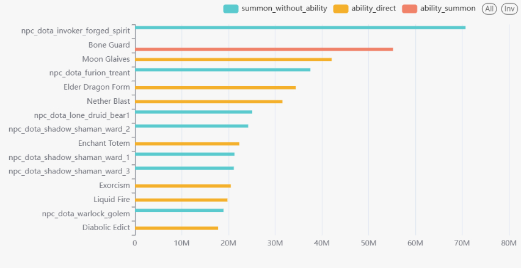
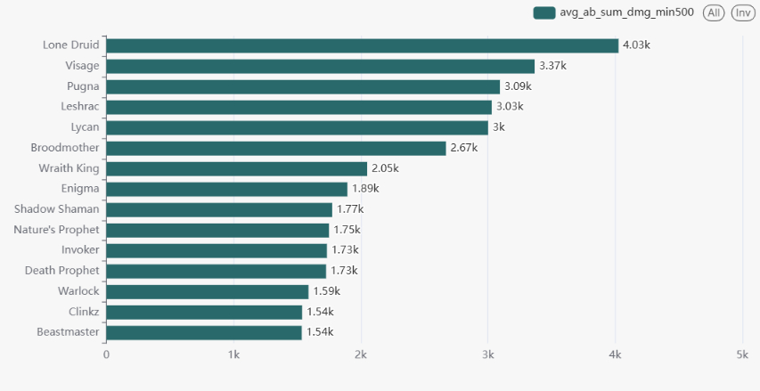
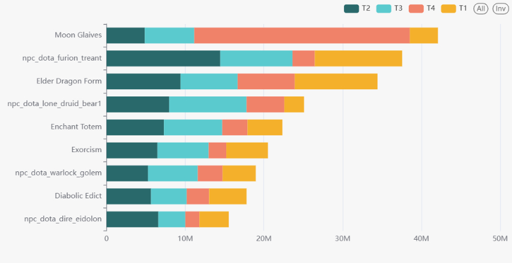
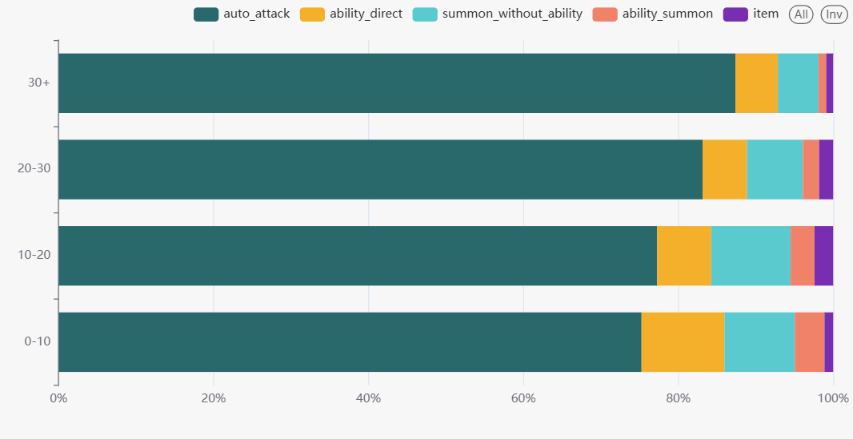
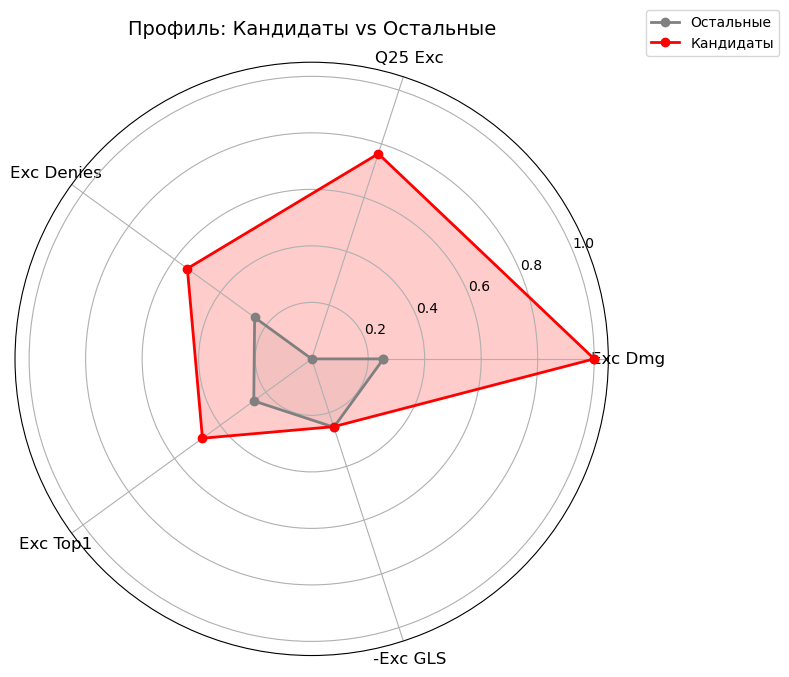
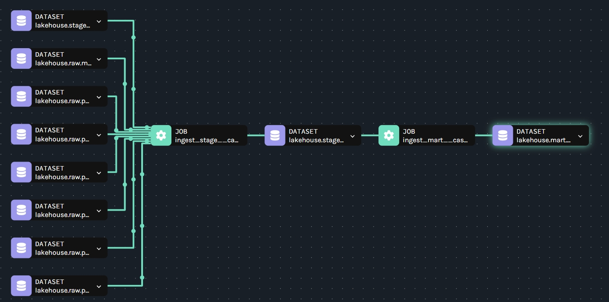

# Dota 2 Analytics — кейсы №13 и №18

Аналитический проект по данным Dota 2, выполненный командой «10» на буткэмпе по Data Engineering (Томск, 12–15 ноября). Репозиторий содержит описание методологии, код ETL-преобразований и исследовательские ноутбуки.

> **Важно:** репозиторий носит демонстрационный характер. Код приведён для иллюстрации подхода и не предназначен для запуска вне платформы Lakehouse — подключения к источникам, конфигурация Spark/Iceberg и оркестрация Airflow остаются за пределами репозитория.

---

## Задача

Заказчику не хватало целостной аналитики для объективной оценки эффективности игроков Dota 2: понимания того, какие герои и игровые механики обеспечивают урон по башням, а также выявления игроков с нетипично высокими показателями. Абсолютные значения статистики без учёта контекста матча, игрового времени, роли и ранга приводили к неверным выводам.

Без такой аналитики сложнее находить закономерности в игровом процессе, сравнивать эффективность героев и обнаруживать потенциально опытных игроков на новых аккаунтах.

Цель проекта — создать воспроизводимый аналитический процесс и набор метрик, которые позволяют оценивать вклад героев и игровых механик в урон по строениям, выявлять статистически необычные профили игроков и предоставлять результаты в виде аналитических витрин и дашбордов.

---

## Кейс 13. Урон по башням: герои и механики

### Гипотезы

**H1. Вклад героев.** Если нормализовать урон по башням на сыгранный матч (включая матчи с нулевым уроном) и на минуту игры при контроле длительности и разделении режимов с порогом выборки > 500 матчей на героя, то выделится узкий пул героев с непропорционально высоким вкладом в разрушение башен, потому что специализированные осадные способности и призванные юниты наносят структурный урон независимо от базовой автоатаки.

**H2. Фаза матча и тип башни.** Если разбить урон по башням по фазам матча (0–10, 10–20, 20–30, 30+ минут) и тирам башен (T1–T4), то относительный вклад конкретных способностей изменится в ~2–4 раза в зависимости от стадии игры и типа башни, потому что на ранних стадиях автоатаки героев слабее, а в поздней игре масштабируются предметами.

### Результаты

**H1 подтверждена.** После нормирования урона на один сыгранный матч (с учётом нулевых игр), расчёта медиан/темпа в минуту и исключения Turbo (на 217 331 стандартном матче) выделяется чёткая группа героев-саммонеров и осадных магов:

| Герой | Матчи | Ср. урон умениями за матч | Медиана | Урон/мин | Доля в башенном уроне героя |
|---|---|---|---|---|---|
| Lone Druid | 6 195 | 4 030,1 | 2 777 | 98,45 | 85,2% |
| Visage | 3 659 | 3 370,8 | 2 505 | 92,44 | 73,1% |
| Pugna | 9 967 | 3 097,2 | 2 474 | 81,61 | 84,6% |
| Leshrac | 5 828 | 3 035,4 | 2 102 | 80,26 | 77,3% |
| Lycan | 3 366 | 3 001,5 | 2 244 | 84,46 | 66,0% |
| Invoker *(для сравнения)* | 40 491 | 1 735,5 | 1 318 | 42,92 | 55,4% |

Высокий валовый урон популярных героев (`Invoker`, `Luna`, `Dragon Knight`) обусловлен частотой их выбора, тогда как по удельной эффективности за матч и по медиане специализированные саммонеры превосходят их более чем в 2 раза.

**H2 подтверждена** и по стадии матча, и по типу башни:

- **По стадиям:** внутри каждого тира башен доля умений и саммонов падает от ранней игры к лейту примерно в 2–3 раза: для `T1` с 23,33% (0–10 мин) до 10,73% (30+ мин), для `T2` — с 32,96% до 10,35%, для `T3` — с 26,63% до 11,18%. Урон автоатак при этом вырастает почти в 18 раз (~105 млн в 0–10 мин → ~1,93 млрд в 30+ мин).
- **По тирам:** механики чётко специализированы. На ранней стадии (`0-10, T1`) доминируют `Bone Guard` (4,55 млн), `Elder Dragon Form` (3,45 млн), `Nether Blast` (3,37 млн), `Forged Spirit` (2,44 млн) и `Treant` (2,21 млн). В поздней стадии (`30+, T3/T4`) лидирует `Moon Glaives` (27,10 млн) — на сдвоенные башни `T4` приходится около 65% урона этой способности за счёт отскоков между ними (общая доля умений на `T4` в фазе `30+` достигает 13,77%).

### Методология: очистка, каскадное связывание и нормализация

Сырая таблица событий `mongo__tower_damage_events` (~247 млн строк) непригодна для прямого расчёта метрик из-за шума и пропусков. Применены четыре последовательных уровня обработки:

1. **Классификация строений (`npcid`)** - по статичному справочнику `pg__npcs` (ID 16–51) события разделены на `TOWER` (57,41% урона), `BARRACKS` (25,78%), `FORT` (9,18%) и `FILLER` (7,63%). Без этого 42,59% урона в фактах не относились бы к башням.
2. **Выделение механики призыва (`fromnpc`)** - 7 из 15 крупнейших источников урона по башням (`Invoker Forged Spirit`, `Shadow Shaman Wards`, `Furion Treant`, `Lone Druid Bear`, `Warlock Golem`) пишутся в событиях с `byability = 0`, но заполненным `fromnpc > 0`. Введена категория `summon_without_ability` (6,75% урона башням в `Standard`), что почти удвоило видимый вклад умений (с 7,71% до 14,46%).
3. **Каскадное связывание игрока** - из-за заглушек скрытых профилей (`0` и `4294967295`) прямой `JOIN` по `account_id` терял ~19,3% событий и размножал строки. Применён двухшаговый безопасный `JOIN` по уникальным парам `(match_id, account_id)` (80,48% событий) → fallback `(match_id, attacker = hero_id)` (18,98%). Итог: 100% покрытие игроков внутри согласованных матчей (`is_matched_match = true`).
4. **Полный знаменатель и изоляция режимов** - в витрину `case13_match_summary` через `LEFT JOIN` от `case13_match_players` включены все матчи с нулевым уроном по башням (`Standard` и `Turbo` разделены через `game_mode_group`, 32,24% Turbo-игр отсечены при анализе фаз; 161,8 тыс. матчей без карточки в `pg__matches` изолированы флагом `in_pg_matches = false`).

**Сознательно исключено:**
- `mongo__building_events` (49,8 млн строк) — аудит доказал 100% статичность `npcid` (16–51) в `pg__npcs` и появление всех башен на `-89` сек.; тяжёлый `JOIN` не нужен.
- Неполные матчи (`in_pg_matches = false`, 161,8 тыс. матчей без длительности и событий) — сохранены в `STAGE` для DQ, но исключены из `MART`, чтобы не занижать средний урон на ~32%.

### Визуализация результатов в Superset

**Топ 15 способностей и саммонов по башням:**



**Топ 15 героев по нормализованному урону умениями:**

 

**Распределение урона топ способностей по типам башен:**

 

**Доля и объем механик по стадиям матча:**



### Ключевые особенности данных

| Особенность | Как учтена |
|---|---|
| `account_id` содержит заглушки `0` и `4294967295` (~19% событий) | Каскадное связывание: `account_id` → fallback `(match_id, hero_id)`; несопоставленные без карточки матча (0,54%) отсечены в `MART` |
| Возможны дубли версий из-за `append`-загрузки `RAW` | Детерминированная дедупликация `Window` по `(src_modified_stamp, sys_insert_stamp, job_id, hash)` |
| `byability = 0`, но `fromnpc > 0` (6,75% урона башням в `Standard`) | Выделена категория `summon_without_ability` и единая метка `source_label` |
| В фактах лишь 57,41% урона — башни (42,59% — бараки, трон, филлеры) | Классификация `npcid` через `rlike`; для анализа башен используется `building_category = 'TOWER'` |
| 32,24% матчей относятся к режиму `Turbo` | Разделены через `game_mode_group`; гипотезы проверяются на `Standard` |
| 161,8 тыс. матчей в `pg__match_players` без карточки в `pg__matches` | Размечены флагом `in_pg_matches = false` в `STAGE`; отсечены при расчёте знаменателя в `MART` |

---

## Кейс 18. Обнаружение смурф-профилей

### Гипотезы

**H1. Динамика ранга как индикатор передачи аккаунта.** Если в истории аккаунта наблюдается резкий рост ранга, а винрейт за короткий период превышает среднее значение по сегменту более чем на 15–20%, то это может указывать на передачу аккаунта опытному игроку.

**H2. Стабильное превосходство над сопоставимыми игроками.** Если игрок стабильно превосходит типичных игроков своего героя, причём средний урон превышает эталон более чем на 50%, то его профиль указывает на повышенный игровой опыт.

### Результаты

**H1 опровергнута.** Поле `rank` оказалось снапшотом профиля на дату парсинга (`sys_insert_stamp`), а не на дату матча (`start_time`). Дополнительно: медиана матчей на аккаунт составляет всего 3 при окне наблюдения 18 часов, что делает разделение на «ранние/поздние» матчи статистически ненадёжным. Признак исключён из модели.

**H2 принята.** Ожидалось превышение урона на +50%, фактическое среднее превышение у кандидатов составило **+78%**. Выявлено **859 кандидатов**, результат подтверждён перестановочным тестом. Доля керри (74%) в топ-500 аномальных аккаунтов совпадает с базовой — ролевое смещение отсутствует.

### Методология: тройная нормировка

Сырая статистика непригодна для сравнения игроков напрямую. Применены три последовательных уровня нормировки:

1. **Z-score внутри матча** — `(x − AVG(x)_матч) / STDDEV_SAMP(x)_матч`. Убирает влияние длительности, патча, региона и уровня лобби.
2. **Вычитание эталона героя** — `exc_dmg = z_dmg − E[z_dmg | hero_id]`. Убирает специфику героя: Meepo по дизайну наносит больше урона, чем Crystal Maiden. Эталон считается для героев с ≥100 играми, иначе fallback на эталон позиции.
3. **Нормировка доминирования на позицию** — `exc_top1 = is_top1_dmg − E[is_top1_dmg | farm_role]`. Убирает утечку роли: керри бывает топ-1 по урону в ~28% матчей просто по природе позиции, саппорт — в <1%.

Эффект третьей нормировки измерен: доля керри в топ-500 снизилась с **86% до 74%** и совпала с базовой долей среди кандидатов.

### Модель

Isolation Forest (sklearn), обучается в Jupyter на витрине признаков. Масштабирование — RobustScaler (медиана/IQR, устойчив к выбросам).

```python
IsolationForest(n_estimators=300, max_samples=256, contamination=0.01, random_state=42)
```

**14 признаков модели:** превышения (`avg_exc_dmg/gpm/den/dpm/gls`), устойчивость (`q25_exc_dmg`, `std_exc_dmg`, `share_positive_exc`), нормированное доминирование (`avg_exc_top1/top2/team_share`), поведение в проигранных матчах (`avg_exc_dmg_loss_filled`, `has_losses`), стабильность фарма (`cv_gpm`).

Сознательно исключены: `win_rate_smoothed` (outcome-признак, отражает силу команды), `avg_farm_role` (утечка роли), сырые маркеры (дублируют exc-версии).

**Критерий кандидата:** `avg_exc_dmg > 1.5σ AND q25_exc_dmg > 0.3σ`. Второй критерий — фильтр устойчивости: даже в худших матчах игрок должен быть выше нормы.

### Валидация: перестановочный тест

Чтобы ответить на вопрос «а не случайные ли это выбросы», проведён перестановочный тест: `account_id` перемешивается внутри каждого матча, вся структура данных (герои, статистика, эталоны) сохраняется. Тот же фильтр применяется к «фейковым» аккаунтам.

| | Реальные данные | Перемешанные |
|---|---|---|
| Кандидатов | 859 | ~116 |

Интерпретация: ~743 кандидата (86%) представляют устойчивый многомерный сигнал, ~116 (14%) — неизбежный статистический шум. Если бы модель ловила одномерные выбросы, количество кандидатов при перемешивании не изменилось бы существенно.

### Визуализация радар диаграммы для аномальных профилей по сравнению с остальными


### Ключевые особенности данных

| Особенность | Как учтена |
|---|---|
| `account_id` содержит заглушки 0 и 4294967295 | Исключены фильтром до всех расчётов; матчи с хотя бы одним анонимом удалены через фильтр полноты состава |
| Возможны дубли записей из-за append-загрузки RAW | Дедупликация через `ROW_NUMBER() OVER (PARTITION BY match_id, player_slot ORDER BY sys_insert_stamp DESC)` |
| Медиана матчей на аккаунт = 3 | Порог включения в витрину `matches_count >= 3`|
| Игроки разных ролей имеют разные показатели | Нормировка доминирования на `farm_role`|
| Поле `rank` — снапшот на дату парсинга | Полностью исключено из признаков |

---

## Данные

| Источник | Сущности | Назначение |
|---|---|---|
| PostgreSQL | `pg__matches` | Длительность матча, игровой режим, тип лобби, результат |
| PostgreSQL | `pg__match_players` | Основная статистика игроков; формирование профилей через `account_id`; сверка `tower_damage` в кейсе 13 |
| PostgreSQL (справочники) | `pg__game_modes`, `pg__lobby_types` | Расшифровка режимов и типов лобби |
| PostgreSQL (справочники) | `pg__heroes` | Названия и характеристики героев |
| PostgreSQL (справочники) | `pg__npcs` | Расшифровка NPC, зданий и призванных существ |
| PostgreSQL (справочники) | `pg__abilities`, `pg__hero_abilities` | Расшифровка способностей и связь с героями |
| PostgreSQL (справочники) | `pg__items`, `pg__neutral_items` | Расшифровка предметов в событиях урона |
| MongoDB | `mongo__tower_damage_events` | События урона по зданиям: источник, цель, величина |
| MongoDB | `mongo__building_events` | Проверка классификации ID зданий |

**Объёмы (кейс 13):** ~322 тыс. матчей, 4,85 млн строк игроков и ~247 млн событий урона в RAW → 4 845 102 строки (48,20 МБ) и 246 912 008 событий (2,39 ГБ) в STAGE → 3 216 290 строк (120,82 МБ) в `case13_match_summary` и 18 080 385 строк (291,09 МБ) в `case13_tower_ability` в MART.

**Объёмы (кейс 18):** ~317 тыс. матчей и ~4.7 млн строк игроков в RAW → 1 177 770 строк в STAGE (117 657 полностью открытых матчей) → 104 857 профилей в MART.

---

## Архитектура

| Категория | Инструмент | Роль |
|---|---|---|
| Источники | PostgreSQL | Структурированные данные |
| Источники | MongoDB | Документы и игровые события |
| Интерфейс | Streamlit / UI | Настройка и запуск потока, data-каталог |
| Оркестрация | Airflow | Порядок, зависимости, статусы |
| SQL-движок | Trino | Выполнение SQL-запросов |
| Обработка | Spark | Очистка, JOIN, агрегация, запись |
| Хранение | MinIO S3 | Хранение данных |
| Табличный слой | Iceberg | Управление аналитическими таблицами |
| Исследование | Jupyter | Анализ и проверка гипотез |
| Представление | Superset | Метрики, графики и выводы |
| Lineage | Marquez | Диаграммы потоков данных |

### Слои

```
RAW (PostgreSQL + MongoDB)
  ↓ очистка, дедупликация, нормировка
STAGE
  ├── case_18_smurf_player_context
  ├── case13_match_players
  └── case13_tower_damage
  ↓ агрегация под аналитические запросы
MART
  ├── case_18_smurf_account_features
  ├── case_13_match_summary
  └── case_13_tower_ability
  ↓
Superset (дашборды) + Jupyter (скоринг Isolation Forest)
```

SQL-трансформации пишутся в UI, платформа автоматически генерирует DAG в Airflow с запуском по расписанию (частота обновления — 1 раз в час).

### Пример визуализации data lineage для витрины case_13_tower_ability в Marquez



---

## Структура репозитория

```
alpha_bank_data_engineering_bootcamp/
├── README.md
├── .gitignore
├── assets/   # Картинки для README:
│ 
├── pipeline/
│   ├── stage/
│   │   ├── case_18_smurf_player_context.sql  # Контекст игрока в матче: z-score внутри матча, эталоны по герою, farm_role, gold_leftover_share
│   │   ├── case13_match_players.py           # Дедупликация и каскадное связывание игроков с событиями урона
│   │   └── case13_tower_damage.py            # Парсинг событий урона по башням, классификация зданий и фаз
│   └── mart/
│       ├── case_18_smurf_account_features.py # Профиль аккаунта: 41 признак
│       ├── case_13_match_summary.sql         # Сводка «игрок × матч» - агрегация урона по башням
│       └── case_13_tower_ability.sql         # Детализация урона по способностям и тирам башен
│ 
├── notebooks/
│   ├── case13/
│   │   ├── case13_data_quality.ipynb         # Аудит RAW-источников
│   │   ├── case13_hypothesis_check.ipynb     # Проверка H1 (вклад героев) и H2 (фаза × тир)
│   │   └── case13_stage_analysis.ipynb       # Проверка STAGE-таблиц:
│   └── case18/
│       ├── init_EDA.ipynb                    # Первичная разведка
│       ├── main_EDA.ipynb                    # Глубокий анализ
│       └── pipeline_test_and_ML.ipynb        # Сквозной прогон STAGE→MART→Isolation Forest, верификация витрины, визуализации
```

Файлы в `pipeline/` соответствуют процессам, зарегистрированным на платформе. Ноутбуки содержат исследовательскую часть: разведку данных, проверку гипотез, обучение модели и построение графиков.

---

## Выводы

### Кейс 13

- **Популярность ≠ осадный импакт.** По удельному урону за матч и медиане лидируют саммонеры и осадные маги (`Lone Druid` 4,03k / медиана 2 777 против `Invoker` 1,74k / медиана 1 318), а не популярные.
- **Без `fromnpc` теряется почти половина урона умений.** Категория `summon_without_ability` (`byability = 0, fromnpc > 0`) даёт 6,75% всего урона по башням в `Standard` против 7,71% от явных `byability > 0`.
- **Умения задают темп в ранней игре, автоатаки в лейте.** Доля умений падает в 2–3 раза от ранней игры к лейту (`T1`: 23,33% → 10,73%; `T2`: 32,96% → 10,35%; `T3`: 26,63% → 11,18%); исключение — отскоки `Moon Glaives` на парных `T4` (13,77% в фазе `30+`).

### Кейс 18

- **Смурф-профиль многомерен и требует нормировки на роль.** Isolation Forest выявил 859 кандидатов по различным метрикам; нормировка убрала перекос в кэрри (86% → 74%).
- **Динамика MMR недоступна на текущих данных.** Малое количество матчей на игрока, поле `rank` — снапшот на дату парсинга, а не матча, поэтому резкий буст отследить нельзя.


---


## Команда

| Участник | Роль | Вклад |
|---|---|---|
| Бурнаков Никита | DE | Исследование данных кейса 13, предобработка, анализ структуры источников, ETL-преобразования для анализа урона по башням |
| Малахова Ирина | DE | Исследование данных кейса 18, предобработка, сбор результатов обоих кейсов, отчётность и документация |
| Архипов Александр | DE | Продолжение исследования и предобработки, доработка кейса 18, формирование признаков и подготовка данных для анализа профилей игроков |

---
